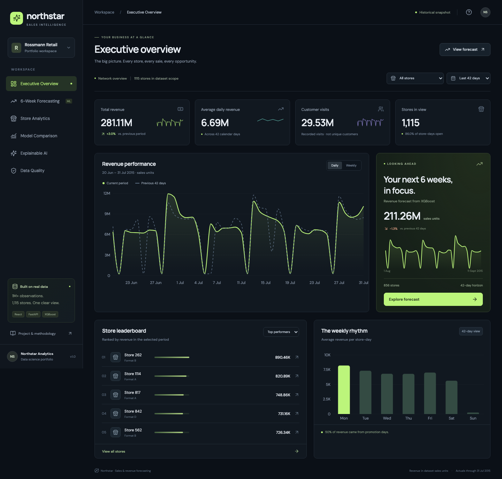

# Northstar — Sales & Revenue Forecasting Platform

A full-stack data science portfolio project built from the actual Rossmann Store Sales archive in this folder. React + TypeScript presents six interactive dashboards; FastAPI serves source-backed analytics and forecasts produced by Python, XGBoost, and Ridge regression.



## Run locally

The repository includes a compressed snapshot of the historical data and trained model outputs. Start the complete production build with:

```bash
./start.sh
```

Open **http://127.0.0.1:8000**. API documentation is at **http://127.0.0.1:8000/docs**. Keep the terminal running; press Ctrl+C to stop. If port 8000 is in use, use `PORT=8001 ./start.sh`.

To regenerate forecasts after a data or model change:

```bash
./start.sh --retrain
```

### Fresh installation

Use **Python 3.11 or 3.12** and **Node 22.12+** (Node 24 LTS is also suitable). Run `./start.sh` to install serving dependencies, build the frontend, and use the included snapshot. The original archive and training libraries are only needed to retrain.

For training on macOS, XGBoost requires OpenMP: install it with `brew install libomp`. On Debian/Ubuntu, install `libgomp1` if missing. Place your `rossmann-store-sales.zip` in the project root, then run:

```bash
python3.11 -m venv .venv
.venv/bin/python -m pip install -r backend/requirements-training.txt
.venv/bin/python scripts/extract_data.py
.venv/bin/python -m backend.pipeline
.venv/bin/python scripts/package_runtime.py
npm --prefix frontend ci
./start.sh
```

The original archive and extracted CSVs stay local and are excluded from Git. The committed runtime snapshot contains the historical columns needed by the dashboard, store metadata, and model outputs.

### Development

Run these in separate terminals from the project root:

```bash
.venv/bin/uvicorn backend.app:app --reload --host 127.0.0.1 --port 8000
npm --prefix frontend run dev
```

Open **http://127.0.0.1:5173**. Vite forwards API requests to FastAPI. The local production build uses one process; Vercel routes two services through one origin.

## GitHub and Vercel deployment

The repository includes a compact, read-only serving snapshot so the hosted dashboard can run without the original ZIP or a model-training job during deployment. Original source CSVs, model binaries, virtual environments, and credentials are excluded from Git.

Vercel Services (currently beta) deploys the frontend and backend together:

- `frontend/`: Vite builds the React site into static assets.
- `backend/`: FastAPI serves analytics from the packaged historical snapshot and precomputed forecasts.
- `vercel.json`: routes `/api/*`, `/docs`, and `/openapi.json` to FastAPI; the remaining paths go to the frontend.

The runtime installs only the dependencies needed for serving. XGBoost training stays in the reproducible local pipeline. The deployed app presents the same historical results and filters as the local app; it does not retrain when visited.

After updating the source data or retraining, regenerate the runtime snapshot, commit it with the code, and push to the connected GitHub repository:

```bash
.venv/bin/python scripts/package_runtime.py
```

Vercel's Git integration can then rebuild the application. Snapshot files include checksums that the API validates at startup.

## Six dashboard pages

| Page | Functionality |
| --- | --- |
| Executive Overview | Period/store filters, real revenue and customer counts, previous-period growth, daily/weekly charts, high/low revenue stores, weekday patterns |
| 6-Week Forecasting | 14/28/42-day horizons, three model choices, daily/cumulative views, individual-store indicative error ranges, CSV export |
| Store Analytics | Store search, format filter, sorting, pagination, store history, observed promotion associations, revenue per open day |
| Model Comparison | Chronological holdout scores, actual vs predicted sales, WAPE/RMSPE selection, MAE, RMSE, bias, validation notes |
| Explainable AI | Exact Tree SHAP global importance and local contributions for each forecast store, explicit log-space additivity |
| Data Quality & Monitoring | Calendar coverage, missing fields and treatment, duplicates, invalid targets, zero-sales checks, completed pipeline stages and source freshness |

All views include loading/error states. Navigation is responsive, keyboard accessible, and supports hash URLs such as `/#forecast`. CSV exports preserve competition IDs, Store, Date, Open, Promo, prediction, and model name.

## Dataset and honest scope

- **1,017,209** historical rows, **1,115** stores, January 1, 2013 through July 31, 2015.
- The future schedule contains **856** stores and **48** days. The requested six-week view uses **August 1 through September 11, 2015**.
- The app uses dataset **sales units**, without assuming a currency absent from the files.
- There are no SKU-level sales, product prices, or competitors’ sales volumes. Competitor proximity is a store attribute, not a market-share measure.
- Customer counts are visits, not unique customers. Customers are excluded from model features because future customer counts are unavailable.
- This is a historical portfolio demonstration, **not a live 2026 sales feed**. Pipeline status describes a completed local run. No scheduled refresh, drift detector, or external BI service is connected.

## Modeling

1. Hold out the final **42 days** (June 20–July 31, 2015; 46,830 store-days).
2. Fit all target-derived features on history through June 19 only. Historical store, weekday, and promotion means use up to the prior 365 days of open, positive-sales observations in the fitting partition.
3. Train XGBoost (360 trees, depth 7) and Ridge on `log1p(Sales)` for open, positive-sales days. Calendar, known promotions, holidays, store metadata, and fitting-only historical averages form 21 features.
4. Compare all three models on the same holdout, with scheduled closures overridden to zero. Predictions are nonnegative.
5. Refit the two learned models and historical lookup features on all actual history for the supplied future schedule.
6. Compute exact Tree SHAP with XGBoost’s native `pred_contribs`. Global importance uses 1,000 seeded open future rows; local explanations use each store’s first scheduled open day.

| Model | MAE | RMSE | RMSPE | WAPE |
| --- | ---: | ---: | ---: | ---: |
| XGBoost | 545.48 | 843.28 | 13.27% | 9.09% |
| Ridge | 723.02 | 1,233.69 | 17.15% | 12.04% |
| Historical baseline | 589.20 | 944.68 | 13.84% | 9.82% |

The baseline is the mean of historical sales for the same store, weekday, and promotion flag, falling back to weekday, store, then global means. Full details, definitions, and limitations are in [the model card](docs/model-card.md).

## Architecture

```text
Rossmann ZIP → CSV validation → chronological train/holdout split
                              ↓
                   features → XGBoost / Ridge / baseline
                              ↓
              evaluation + full refit + forecasts + Tree SHAP
                              ↓
                  local CSV / JSON / model artifacts
                              ↓
                      FastAPI analytics endpoints
                              ↓
                React + TypeScript + Recharts dashboard
```

The training pipeline is separate from request handling. The API loads immutable source data and precomputed model outputs at startup, and caches common analytics queries. Restart the server after retraining. No database or paid account is needed.

```text
backend/pipeline.py       Training, validation, prediction, SHAP, quality audit
backend/app.py            FastAPI analytics and CSV export routes
backend/runtime.py        Lightweight serving data loader and shared metrics
backend/runtime_data/     Compressed history and model outputs for deployment
backend/artifacts/        Generated models, forecasts, metrics, explanations
frontend/src/             React dashboard and responsive design
frontend/e2e/             Browser interaction tests
scripts/extract_data.py   Safe extraction of known dataset members
scripts/package_runtime.py  Validate and package results for deployment
start.sh                  Build and serve app + API on one origin
```

## Verification

```bash
.venv/bin/python -m pip install -r backend/requirements-training.txt
.venv/bin/python -m pytest tests -q
npm --prefix frontend run build
# With the development servers running:
cd frontend
npx playwright install chromium
npx playwright test
```

Backend integration tests use the original local dataset and training artifacts to independently reconcile sales totals, customer counts, model scores, forecast exports, store coverage, SHAP additivity, and target-feature isolation. Deployment checks verify snapshot parity, startup without training libraries, and export size limits. Browser tests cover all six pages, filter changes, downloads, search/empty states, mobile navigation, layout overflow, and the methodology dialog.

## API

`GET /api/meta`, `/api/health`, `/api/overview`, `/api/forecast`, `/api/forecast/export`, `/api/stores`, `/api/models`, `/api/explain`, `/api/quality`.

`store=0` means the complete relevant cohort. Historical pages support 7–180 days. Forecasts support 7–42 days and `model=XGBoost|Ridge|Baseline`. Forecast requests for historical-only stores return a clear 404. Invalid controls return 422.

## Portfolio use

The React website is the deliverable requested in the brief. A methodology dialog, model card, and API documentation are included for demonstrations. The source repository is private; the hosted dashboard presents historical analytics and forecasts. The original archive and training model binaries are excluded from Git. No Power BI publication or connection is required.
