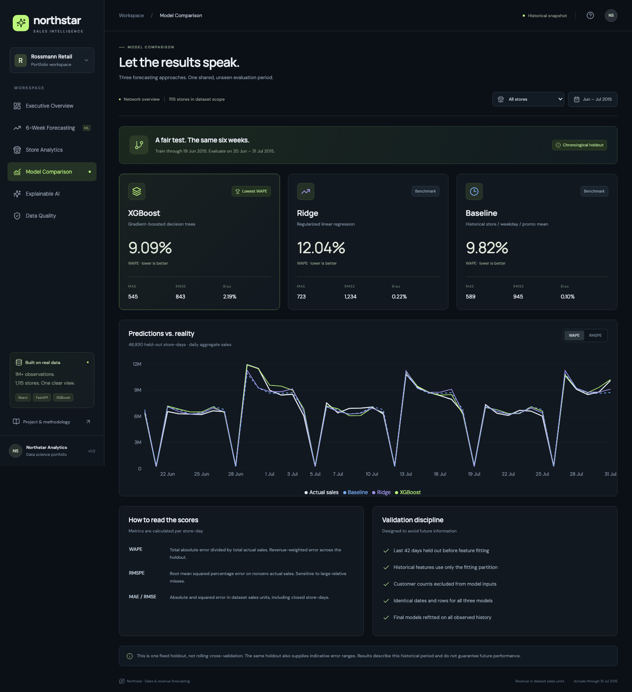
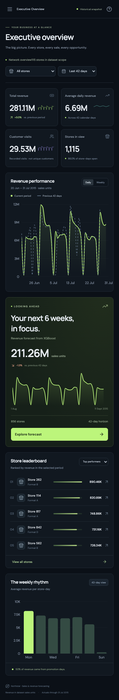
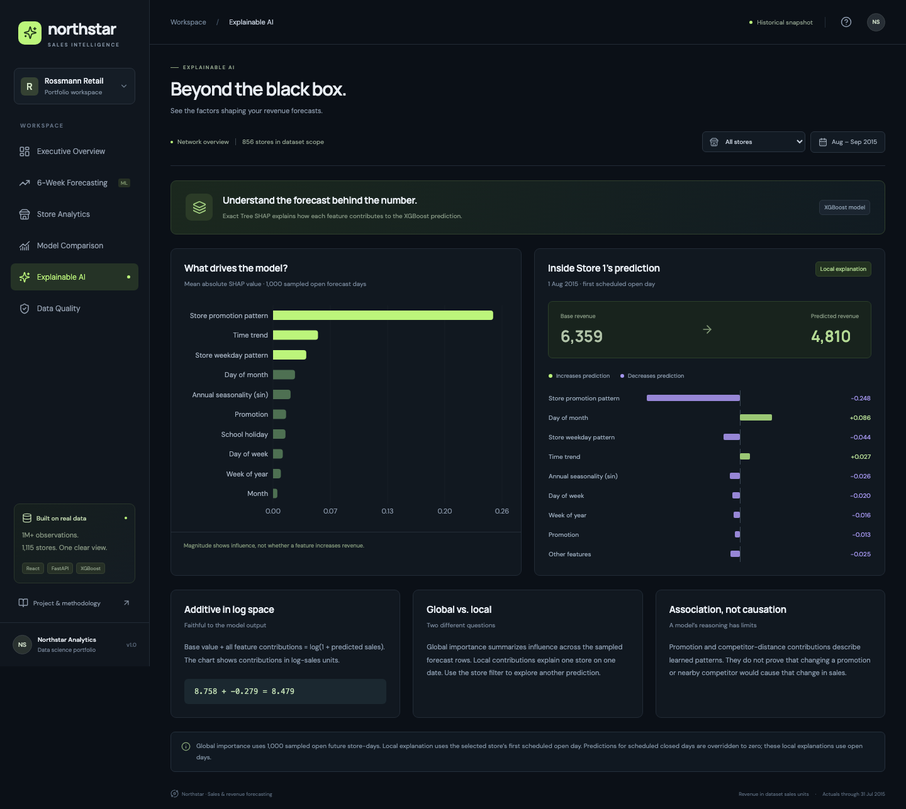
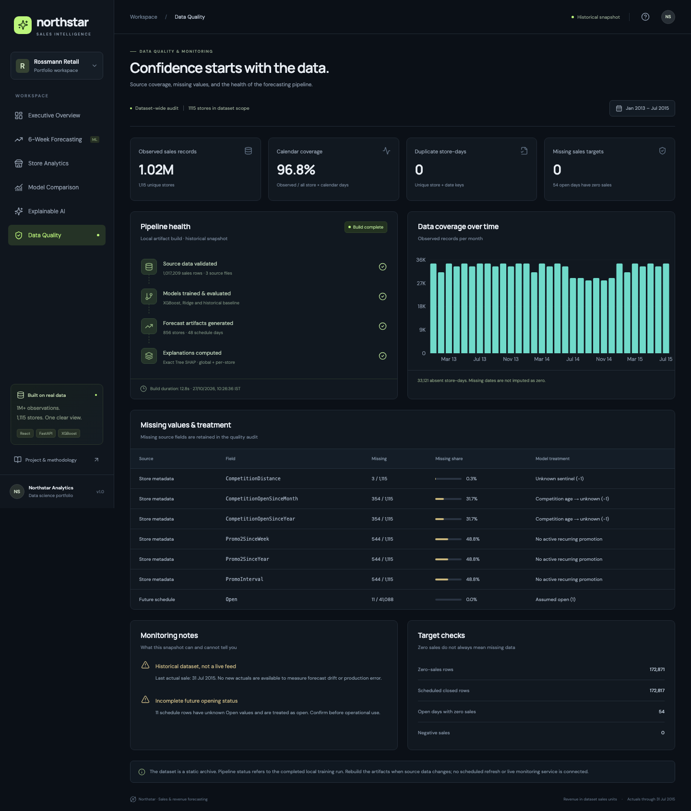

# Salevora — Sales & Revenue Forecasting

[](https://github.com/kvvraju24/salevora/actions/workflows/ci.yml)


**End-to-end machine learning project: an XGBoost model forecasts six weeks of daily sales for 856 retail stores, served through a FastAPI backend to an interactive React dashboard with model comparison and SHAP explanations.**

**[▶ Live demo](https://salevora.vercel.app)** · **[API docs](https://salevora.vercel.app/docs)** · **[Model card](docs/model-card.md)**


## Results at a glance

Trained on **1,017,209 daily records from 1,115 Rossmann stores** (Jan 2013 – Jul 2015) and evaluated on a **42-day chronological holdout of 46,830 store-days** the models never saw during training.

| Model | WAPE ↓ | RMSPE ↓ | MAE ↓ | RMSE ↓ |
| --- | ---: | ---: | ---: | ---: |
| **XGBoost** | **9.09%** | **13.27%** | **545** | **843** |
| Historical baseline | 9.82% | 13.84% | 589 | 945 |
| Ridge regression | 12.04% | 17.15% | 723 | 1,234 |

XGBoost cuts absolute error by **7.4%** and RMSE by **10.8%** against a strong store × weekday × promotion baseline, and beats it on every metric.

## What I built

- **ML pipeline (Python, pandas, scikit-learn, XGBoost).** Leakage-safe chronological validation, 21 engineered features (calendar, promotions, holidays, store format, competition, historical means fitted on training dates only), log-target training, and a full refit for the future schedule.
- **Explainable AI.** Exact Tree SHAP via XGBoost's `pred_contribs`: global feature importance plus per-store explanations of individual forecasts, with additivity checked by tests.
- **REST API (FastAPI).** Nine typed, validated, read-only endpoints with interactive OpenAPI docs, cached aggregation over 1M+ rows, CSV forecast export, and security headers.
- **Dashboard (React 19 + TypeScript + Recharts).** Six responsive pages: executive KPIs, 6-week forecasting, store analytics, model comparison, explainable AI and data-quality monitoring. Keyboard accessible and mobile friendly.
- **Testing and deployment.** pytest integration tests reconcile every figure to the source CSVs, and Playwright browser tests cover all pages on desktop and mobile. GitHub Actions CI, plus a checksummed data snapshot so the app deploys to Vercel without the training stack.

## Dashboard pages

| Model comparison | Mobile layout |
| --- | --- |
|  |  |
| **Explainable AI (SHAP)** | **Data quality** |
|  |  |

| Page | What it shows |
| --- | --- |
| Executive Overview | Revenue, customer visits and growth versus the previous period; daily and weekly trends; best and worst stores; weekday pattern |
| 6-Week Forecasting | 14/28/42-day horizons, choice of three models, daily or cumulative view, per-store error range, CSV export |
| Store Analytics | Search, filter by format, sort and paginate 1,115 stores; store history; promotion comparison |
| Model Comparison | Holdout scores, actual-versus-predicted chart, worst-forecast stores, metric definitions |
| Explainable AI | Global SHAP importance and the drivers behind each store's forecast |
| Data Quality | Calendar coverage, missing values and how they were treated, duplicates, invalid targets, pipeline provenance |

## Architecture

```text
Kaggle Rossmann CSVs ─► validation ─► chronological train / holdout split
                                         │
                       feature engineering (fit on training dates only)
                                         │
                 XGBoost  ·  Ridge  ·  historical baseline  ─► holdout metrics
                                         │
                 full refit ─► 6-week forecasts ─► Tree SHAP explanations
                                         │
              checksummed compressed snapshot (≈ 8.7 MB, committed)
                                         │
                FastAPI (read-only, cached)  ─►  React + Recharts dashboard
```

Training runs offline. The API only reads precomputed results, so the hosted app starts in seconds and needs no ML libraries.

## Key design decisions

- **Chronological holdout, not a random split.** Random splits leak future information in time series. The final 42 days are held out, and every target-derived feature is fitted only on earlier dates. A test checks this.
- **WAPE as the headline metric.** It weights errors by sales volume, so a large store's error counts more than a small store's. RMSPE (the Kaggle metric) is reported alongside it.
- **Log-transformed target.** Sales are right-skewed. Training on `log1p(Sales)` stabilises variance, and predictions are clipped to be non-negative and set to zero for scheduled closures.
- **A baseline worth beating.** The baseline is a store × weekday × promotion mean, not a naïve constant. XGBoost has to earn its complexity.
- **Honest uncertainty.** Error ranges are shown only for individual stores. Summing them for the whole network would overstate confidence, because store errors are correlated.

## Run locally

Requires **Python 3.11 or 3.12** and **Node 22.12+**.

```bash
git clone https://github.com/kvvraju24/salevora.git
cd salevora
./start.sh            # installs dependencies, builds the UI, serves everything
```

Open **http://127.0.0.1:8000**. The API docs are at **/docs**. If port 8000 is busy, use `PORT=8001 ./start.sh`.

<details>
<summary><b>Retrain the models from the original data</b></summary>

Download `rossmann-store-sales.zip` from the [Kaggle competition](https://www.kaggle.com/c/rossmann-store-sales/data) and place it in the project root. On macOS, XGBoost needs OpenMP (`brew install libomp`); on Debian/Ubuntu, install `libgomp1`.

```bash
python3.11 -m venv .venv
.venv/bin/python -m pip install -r backend/requirements-training.txt
.venv/bin/python scripts/extract_data.py      # extracts only the four known CSVs
.venv/bin/python -m backend.pipeline          # train, evaluate, forecast, explain
.venv/bin/python scripts/package_runtime.py   # rebuild the checksummed snapshot
./start.sh
```

Or run it all in one go with `./start.sh --retrain`.
</details>

<details>
<summary><b>Development mode and tests</b></summary>

```bash
# two terminals
.venv/bin/uvicorn backend.app:app --reload --host 127.0.0.1 --port 8000
npm --prefix frontend run dev                 # http://127.0.0.1:5173

# tests
.venv/bin/python -m pytest tests -q           # full suite needs the original data
npm --prefix frontend run build
cd frontend && npx playwright install chromium && npx playwright test
```

The backend tests independently reconcile sales totals, customer counts, model scores, forecast exports, store coverage, SHAP additivity and feature isolation against the source data. CI runs the snapshot-only subset, because the Kaggle archive is not redistributed.
</details>

## Deployment

`vercel.json` deploys two services behind one origin: the Vite-built frontend, and the FastAPI backend that serves `/api/*` and `/docs`. The backend installs only its serving dependencies and checks the snapshot's SHA-256 checksums at startup, refusing to serve partial or mixed data.

## API

`GET /api/health` · `/api/meta` · `/api/overview` · `/api/forecast` · `/api/forecast/export` · `/api/stores` · `/api/models` · `/api/explain` · `/api/quality`

- `store=0` means all stores.
- Historical pages accept `days` = 28, 42, 90 or 180.
- Forecasts accept a `horizon` of 7–42 days and `model` = `XGBoost`, `Ridge` or `Baseline`.
- Invalid input returns 422. Unknown stores, and stores that have history but no forecast schedule, return 404.

## Security

The API is read-only and same-origin, with typed and bounded inputs, and there are no secrets in the repository. Responses carry a Content-Security-Policy, `X-Frame-Options`, `nosniff`, `Referrer-Policy` and `Permissions-Policy`. Historical queries only accept the periods the UI offers, which keeps the cache effective.

## Scope and limitations

- This is a **historical** dataset (2013–2015), not a live sales feed. Forecasts cover 1 Aug – 11 Sep 2015, the period of Kaggle's future schedule.
- Values are dataset sales units; the data has no currency, SKU, price or competitor-sales information.
- Customer counts are visits, not unique customers. They are excluded from the model's features, because future visits are unknown at forecast time.
- See the [model card](docs/model-card.md) for full definitions and limitations, and the [verification notes](docs/verification.md) for the test log.

## Project structure

```text
backend/pipeline.py         training, validation, forecasting, SHAP, data-quality audit
backend/app.py              FastAPI routes, validation, security headers
backend/runtime.py          lightweight snapshot loader and shared metrics
backend/runtime_data/       compressed, checksummed serving snapshot
frontend/src/               React + TypeScript dashboard
frontend/e2e/               Playwright browser tests
tests/                      pytest integration and deployment tests
scripts/                    safe data extraction and snapshot packaging
```

## Data and licence

Data: [Rossmann Store Sales](https://www.kaggle.com/c/rossmann-store-sales) (Kaggle), used for non-commercial demonstration. The original archive is not redistributed. Code: [MIT](LICENSE).

---

**Koneti Vishnuvardhan Raju** · [GitHub](https://github.com/kvvraju24) · open to Data Science / ML roles
